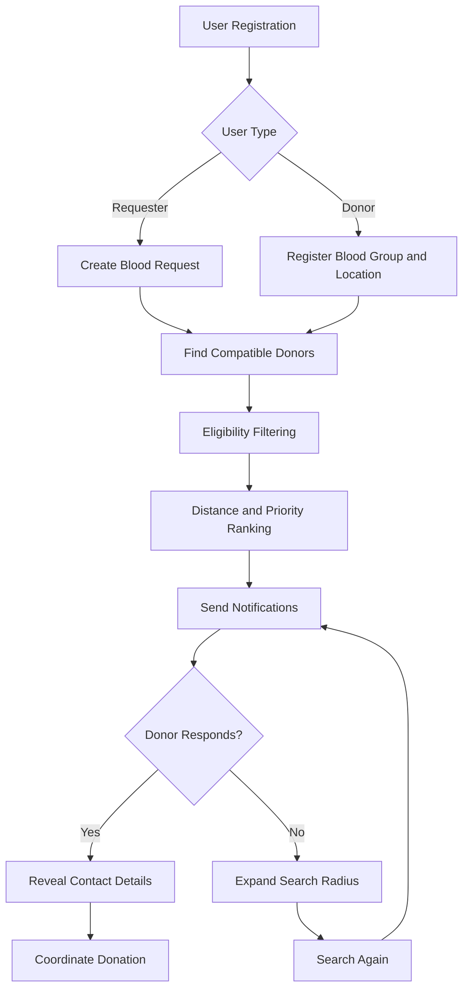

# 🩸 Blood Donor Finder

**Connecting Blood Donors with People in Need — Faster, Smarter, and Safer.**

Blood Donor Finder is a web application designed to connect people who urgently need blood with nearby, compatible, and eligible blood donors in real time. The platform simplifies the blood donation search process through intelligent donor matching, automatic search radius expansion, and privacy-first communication.

Our mission is to reduce the time required to find blood donors during emergencies and make blood donation more accessible through technology.

---

## 📌 Table of Contents

- [About the Project](#-about-the-project)
- [Why This Project?](#-why-this-project)
- [How It Works](#-how-it-works)
- [Key Features](#-key-features)
- [Smart Donor Matching](#-smart-donor-matching)
- [Privacy and Security](#-privacy-and-security)
- [System Workflow](#-system-workflow)
- [Future Enhancements](#-future-enhancements)
- [Team Members](#-team-members)
- [Getting Started](#-getting-started)
- [Contributing](#-contributing)

---

## 📖 About the Project

Blood Donor Finder is a centralized platform that helps patients, families, and hospitals find suitable blood donors during emergencies.

Instead of relying on WhatsApp groups, social media posts, or unorganized phone contacts, users can submit a blood request and get connected with compatible donors based on:

- Blood group compatibility.
- Geographical proximity.
- Donor eligibility.
- Previous response history.
- Time since the last donation.

The system prioritizes relevant donors and automatically expands the search area if no donor responds.

## ❓ Why This Project?

### 1. Solving a Real-World Problem

During medical emergencies, finding a suitable blood donor can be difficult and time-consuming.

Families often depend on social media groups, personal contacts, and manual searches. This creates delays when every minute matters.

Blood Donor Finder aims to reduce this effort by providing a centralized, intelligent, and organized donor-matching platform.

### 2. Limitations of Existing Solutions

Many traditional blood donor directories have limitations:

- Static donor information without real-time availability.
- No automated donor eligibility checks.
- No intelligent donor prioritization.
- No automatic search radius expansion.
- Limited privacy controls for donor contact information.

### 3. Our Solution

Blood Donor Finder addresses these challenges through:

- Intelligent donor matching.
- Location-based donor discovery.
- Eligibility-based filtering.
- Automatic search radius expansion.
- Privacy-first contact sharing.
- Admin verification and spam prevention.

---

## ⚙️ How It Works

The application follows a simple workflow:

### Step 1: Donor Registration

Donors create an account and provide:

- Name and contact information.
- Blood group.
- Current location.
- Last blood donation date.

### Step 2: Blood Request Creation

A requester submits a blood requirement with:

- Required blood group.
- Hospital name and location.
- Number of blood units needed.
- Emergency priority.
- Additional request details.

### Step 3: Intelligent Donor Matching

The matching engine identifies compatible donors based on blood group, location, and eligibility criteria.

Only donors satisfying the defined eligibility rules are considered.

### Step 4: Donor Notifications

Matched donors receive notifications through email or SMS.

Their contact details remain private until they accept the blood request.

### Step 5: Automatic Radius Expansion

If nobody responds within the configured time, the system automatically expands the search radius:

| Search Stage | Radius |
|---|---|
| First Search | 3 KM |
| Second Search | 5 KM |
| Third Search | 10 KM |

This increases the chances of finding an available donor.

### Step 6: Request Completion

Once a donor accepts the request, the requester can access the donor's contact information and coordinate further communication.

---

## ✨ Key Features

| Feature | Description |
|---|---|
| Donor Registration | Register donors with blood group and location details. |
| Blood Requests | Create and manage emergency blood requests. |
| Smart Matching | Find compatible and eligible donors automatically. |
| Location-Based Search | Prioritize donors based on geographical distance. |
| Eligibility Filtering | Apply a minimum 3-month donation-gap rule as the project's initial screening criterion. |
| Automatic Radius Expansion | Expand search from 3 KM to 5 KM and then 10 KM. |
| Email/SMS Alerts | Notify matched donors about blood requirements. |
| Privacy Protection | Reveal donor contact information only after acceptance. |
| Admin Dashboard | Verify accounts and manage suspicious activities. |
| Request Management | Track pending, accepted, and completed requests. |

---

## 🧠 Smart Donor Matching

One of the core components of Blood Donor Finder is its intelligent donor-matching engine.

Instead of selecting donors randomly, the system ranks eligible donors using multiple parameters:

**1. Blood Group Compatibility**

Identifies donors compatible with the requested blood group.

**2. Geographical Distance**

Prioritizes donors who are closer to the requesting hospital.

**3. Donation Eligibility**

Filters donors according to the configured minimum donation interval and applicable eligibility rules.

**4. Previous Response History**

Considers historical donor responses to help prioritize reliable communication.

**5. Donation Gap**

Considers the time elapsed since the donor's last donation.

The final ranking helps prioritize suitable donors rather than simply displaying a list of registered users.

*Note: The project's initial three-month screening rule is a software filter, not a medical clearance. Actual donation eligibility must be confirmed by qualified medical personnel and applicable blood-bank guidelines.*

---

## 🔐 Privacy and Security

Donor privacy is an important part of our system.

- Donor contact information is not publicly exposed.
- Contact details are revealed only after a donor accepts a request.
- Admin verification helps reduce fake accounts.
- Spam and suspicious requests can be managed through the admin panel.
- User authentication and access control help protect account information.

---

## 🔄 System Workflow



---

## 🚀 Future Enhancements

We plan to improve Blood Donor Finder with additional capabilities:

- **Live Location Tracking:** Improve location-based donor discovery.
- **Real-Time Notifications:** Add instant push notifications.
- **Blood Bank Integration:** Connect with verified blood banks and hospitals.
- **AI-Based Recommendations:** Explore intelligent donor prioritization.
- **Multilingual Support:** Make the platform accessible to more users.
- **Mobile Application:** Develop Android and iOS applications.
- **Analytics Dashboard:** Provide insights into blood requests, donor activity, and successful connections.

---

## 👨‍💻 Team Members

We are a team of four working together to build a technology-driven solution for a real-world healthcare challenge.

| Name | Role |
|---|---|
| **Tanishk Gautam** | Team Leader |
| Sahil | Team Member |
| Vani Nehra | Team Member |
| Shivi Sharma | Team Member |

---

## 🛠️ Technology Stack

The technology stack will be updated as development progresses.

- **Frontend:** To be finalized.
- **Backend:** To be finalized.
- **Database:** To be finalized.
- **Notifications:** Email / SMS Integration.
- **Version Control:** Git & GitHub.

---

## 💻 Getting Started

Follow these steps to run the project locally once the initial development setup is ready.

### 1. Clone the Repository

```bash
git clone <YOUR_REPOSITORY_URL>
```

### 2. Navigate to the Project Directory

```bash
cd Blood-Donor-Finder
```

### 3. Install Dependencies

Follow the installation instructions according to the selected technology stack.

### 4. Configure Environment Variables

Add the required database credentials, email/SMS configuration, and other environment variables.

### 5. Run the Application

Start the backend and frontend services according to the project's setup instructions.

---

## 🤝 Contributing

We welcome contributions and suggestions that can improve this project.

1. Fork the repository.
2. Create a new feature branch.
3. Make your changes.
4. Commit your changes.
5. Push your branch.
6. Create a Pull Request.

```bash
git checkout -b feature/your-feature-name
git add .
git commit -m "Add: your feature description"
git push origin feature/your-feature-name
```

---

## ❤️ Our Vision

We believe technology should be used to solve meaningful problems.

Blood Donor Finder is more than just a web application. It is an attempt to make finding a blood donor faster, more organized, and more accessible when people need help the most.

**One platform. Faster connections. A meaningful impact.**

---

⭐ If you find this project meaningful, consider giving this repository a star!
